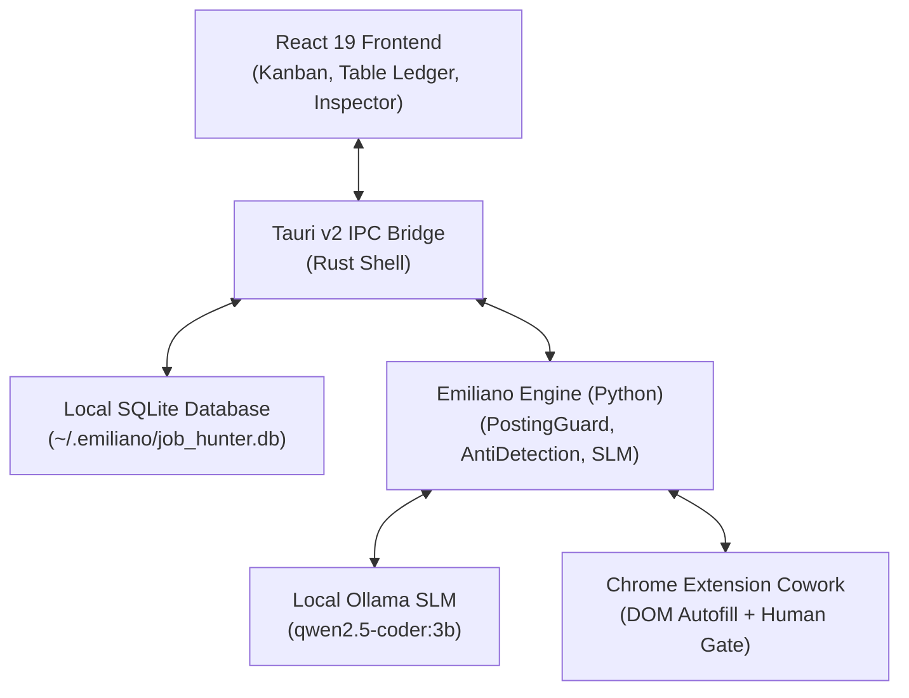

# 💼 Emiliano Job Hunter (`emiliano-job-hunter`)

> **Autonomous AI Career Agent, Multi-CV Variant CRM, and Position Diagnostics Desktop Engine.**  
> Built with **Tauri v2 + React 19 + Tailwind CSS**, local SQLite persistence, adversarial honey-trap sanitization, and Chrome Companion Cowork.

---

## 🌟 Why This Exists (Solving the `ai-job-search` Gap)

Upstream repositories like `ai-job-search` provide prompt templates and CLI scraper scripts, but **completely lack a Graphical User Interface (GUI)**. Users are forced to manually edit raw markdown files and juggle external spreadsheets with zero visual pipeline, zero CV version tracking, and zero database audit trail.

**Emiliano Job Hunter** delivers the complete missing layer:
- 📋 **Visual Kanban & Table CRM**: Real-time application tracking across six stages (`Diagnostic Fit` ➔ `Tailored Pitch` ➔ `Human Gate` ➔ `Submitted` ➔ `Interviewing` ➔ `Offer Extended`).
- 📄 **Multi-CV Variant Mapping**: Directly maps which resume version was used (e.g. Master EN, Polish Localized PL with RODO, Frontend React 19 Canvas, Systems C++).
- 🛡️ **Adversarial Canary Defense (`posting_guard.py`)**: Automatically strips prompt injection attacks, invisible zero-width chars, and hidden recruiter honey-traps before generation.
- 🔍 **Anti-AI Detection Engine (`anti_detection_audit.py`)**: Mathematically enforces sentence burstiness ($\sigma \ge 7.0$) and bans 60+ algorithmic LLM clichés to defeat GPTZero/CopyLeaks.
- ⚡ **Local & Private (Zero Cloud Leaks)**: Runs on local SLMs (`qwen2.5-coder:3b` via Ollama) with a local SQLite database (`~/.emiliano/job_hunter.db`).

---

## 🚀 Quick Start (One Command)

### 1. Prerequisites
- Node.js 18+ & Rust (Cargo)
- Python 3.10+ (for local diagnostic engine)
- Ollama with `qwen2.5-coder:3b` (preloaded)

### 2. Launch the Desktop Application
```bash
# Clone or navigate to the repository
cd emiliano-job-hunter

# Install frontend dependencies
npm install

# Run the Tauri Desktop Application (or browser dashboard)
npm run tauri dev
```

---

## 👤 30-Second Personalization

Anyone can personalize this repository for their own career in three simple steps:

1. **Drop In Resumes (`documents/cv/`):**
   - Copy your master resume PDF into `documents/cv/master_resume.pdf`.
   - Copy any localized CVs (e.g., Polish, German, Spanish) into `documents/cv/localized_cv.docx`.
2. **Configure Candidate Profile (`candidate_profile.json`):**
   - Update your location, target compensation (PLN, EUR, USD), and legal entity (B2B contractor vs. employment).
   - Add **blacklisted past employers** (ensuring you never accidentally apply to previous companies).
3. **Launch & Track:**
   - The visual dashboard automatically syncs your profile, analyzes target postings, and tracks every application in the local database.

---

## 📊 Architecture Diagram



---

## 📄 License
MIT License. Open-source contribution to the Oracliom Ecosystem.
