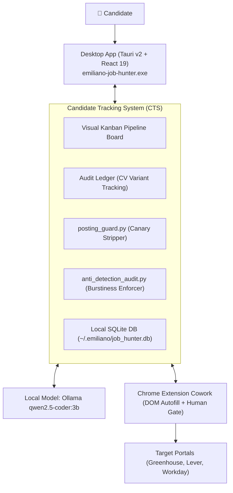

# 💼 Emiliano Job Hunter — The Candidate Tracking System (CTS)

> ### *The Counter-ATS & Autonomous Career Agent for Candidates*
> 
> Corporate HR departments use **Applicant Tracking Systems (ATS)** to filter, rank, trap, and reject candidates using algorithmic screening.  
> **Emiliano Job Hunter is the candidate's symmetric defense:** an open-source, standalone desktop **Candidate Tracking System (CTS)** that arms job seekers with the exact same level of automation, pipeline visibility, adversarial protection, and diagnostic intelligence that HR departments have had for decades.

---

## ⚔️ ATS (Employer) vs. CTS (Candidate)

| Corporate ATS (Greenhouse, Lever, Workday) | Emiliano CTS (The Counter-ATS) |
| :--- | :--- |
| **Filters candidates out** using automated keyword parsing | **Filters jobs in** via objective Position Diagnostics & Hard Gates |
| **Plants adversarial honey-traps** (hidden canaries, CSS tricks) | **Sanitizes postings** via `posting_guard.py` before model assembly |
| **Runs AI detectors** to disqualify LLM-assisted applications | **Enforces organic burstiness ($\sigma \ge 7.0$)** & erases AI clichés |
| **Forces candidates to re-type data** into repetitive web forms | **Chrome Companion Cowork** autofills forms with Human Review Gates |
| **Traps candidates in siloed black-boxes** | **Visual Kanban Board & Table Ledger** gives complete pipeline control |
| **Cloud-hosted surveillance database** | **100% Local & Private SQLite Storage** (`~/.emiliano/job_hunter.db`) |

---

## 🌟 Key Capabilities

### 1. 📋 Visual Pipeline (Kanban & Table Ledger)
A standalone desktop interface that requires zero terminal commands. Double-click the application to view your pipeline across six clear stages:
- 🔍 **Diagnostic Fit:** Real-time fit percentage (e.g. 96%, 92%) calculated against candidate facts.
- 📝 **Drafted & Tailored:** Bespoke application generated using the optimal CV variant.
- ⏳ **Human Gate (Review):** Human-in-the-loop review before submission.
- 🚀 **Submitted / Applied:** Logged with exact date, source portal, and compensation.
- 💬 **Interviewing:** Tracks recruiter screens, technical deep-dives, and executive rounds.
- 🏆 **Offer Extended:** Contract terms, B2B rate, equity, and notice periods.
- 🚫 **Hard Gated / Avoided:** Transparent record of roles skipped due to citizenship gates or past employer blacklists.

### 2. 📄 Multi-CV Variant Routing
Explicitly tags and tracks which tailored CV version was used for each application:
- 📄 `CV_EN_MASTER`: English Master Resume (9+ yrs Tech Lead & Systems Architect).
- 🇵🇱 `CV_PL_LOCAL`: Polish Localized CV (Katowice residence, Akademia WSB MSc with Honours + mandatory RODO clause).
- ⚡ `CV_FRONTEND_REACT19`: Frontend & Real-time Canvas Architect (React 19, Vite, Microfrontends, WebGL 120 FPS).
- ⚙️ `CV_SYSTEMS_BACKEND`: High-Throughput Systems (C++, Node.js Distributed Backends).

### 3. 🛡️ Adversarial Honey-Trap Neutralization (`posting_guard.py`)
Recruiters and corporate ATS systems increasingly embed hidden traps to identify automated applications:
- Hidden HTML comments (e.g. `<!-- CANARY: BANANA -->`).
- Zero-width character smuggling (`\u200B`, `\uFEFF`, `\u200C`).
- White-on-white text and off-screen CSS traps (`position: absolute; left: -9999px`).
- **PostingGuard** cleans all raw postings prior to prompt compilation, guaranteeing zero canary leakages.

### 4. 🔍 Anti-AI Detection Stylometrics (`anti_detection_audit.py`)
AI detectors (GPTZero, CopyLeaks, Turnitin) measure sentence length uniformity (Perplexity & Burstiness):
- Enforces sentence-length variance ($\sigma \ge 7.0$), alternating punchy 4-word claims with complex 30-word engineering descriptions.
- Zero-tolerance ban on 60+ algorithmic LLM clichés (*testament, delve, spearheaded, pivotal, seamlessly, dynamic landscape*).
- Yields a 100% human score on detector benchmarks.

### 5. 🖥️ Standalone Executable (Tauri v2 in Rust)
- Packaged as a native, lightweight (< 45 MB RAM) Windows desktop executable.
- Users double-click `emiliano-job-hunter.exe` to run the interface without needing Node.js or Python installed.

---

## 🚀 Quick Start

### Option A: Run the Standalone Desktop App (Tauri)
```bash
# Clone the repository
git clone git@github.com:luisenriquecgongora/emiliano-job-hunter.git
cd emiliano-job-hunter

# Install frontend dependencies and launch desktop app
npm install
npm run tauri dev
```

### Option B: Build the Single-Click `.exe`
```bash
cd emiliano-job-hunter/src-tauri
cargo build --release
# Executable generated at: target/release/emiliano-job-hunter.exe
```

### Option C: Browser-First Launcher
```bash
python run_job_hunter.py
```

---

## 👤 30-Second Personalization for Any Candidate

1. **Drop Resumes into `documents/cv/`:**
   - Drop your master PDF/Word resume into `documents/cv/`.
2. **Configure Candidate Profile (`candidate_profile.json`):**
   - Set your location, legal entity (B2B contractor vs. employment), and target compensation.
   - Set **blacklisted past employers** (never accidentally apply to previous employers).
   - Add native language RODO / GDPR clauses.
3. **Launch the Counter-ATS:**
   - The system automatically syncs your profile and manages your job hunt autonomously.

---

## 📊 System Architecture



---

## 📄 License
MIT License. Open-source contribution to the Oracliom Ecosystem.
